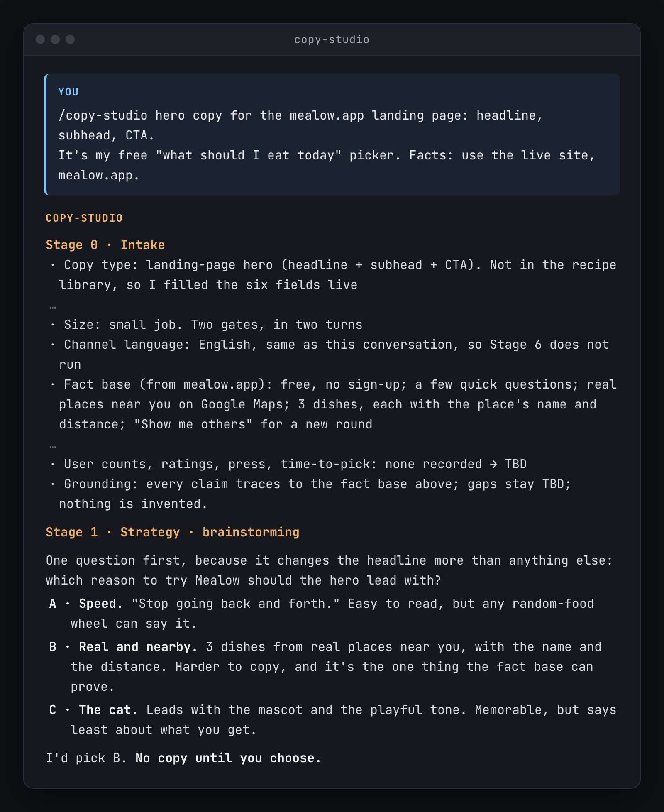
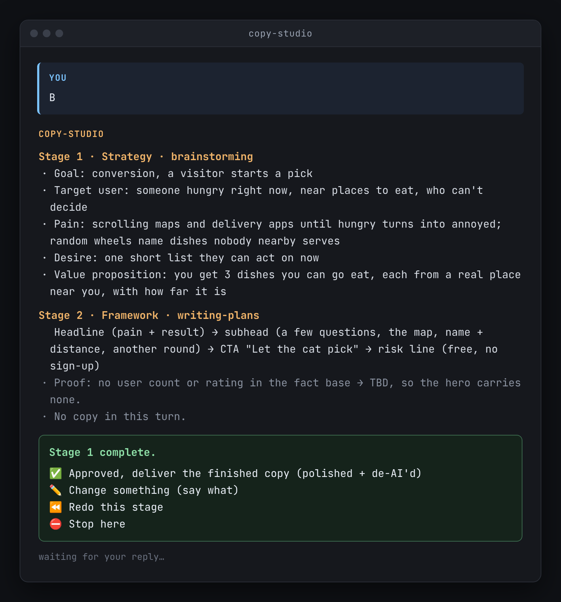
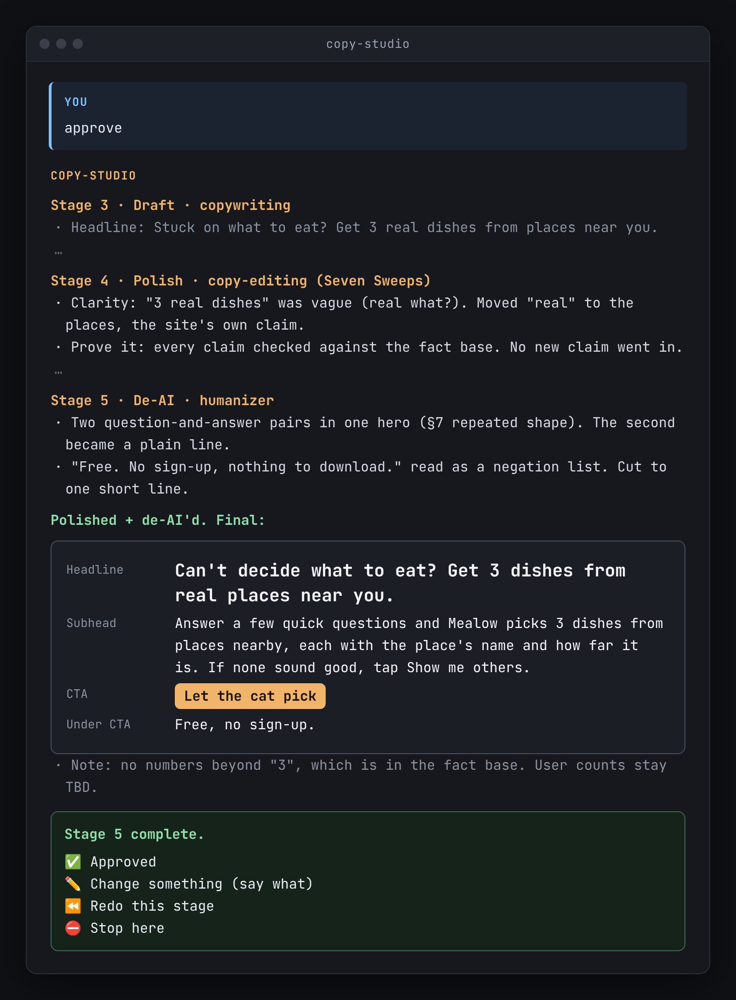

# Copy Studio

[English](README.md) | [简体中文](README.zh-CN.md)

[](LICENSE)
[](https://github.com/Ekko237/copy-studio/releases/latest)
[](CHANGELOG.md)

A Claude Code / Codex skill that takes one marketing-copy job through strategy, framework, draft, polish, and de-AI, stopping for the user's approval after each stage. It has an optional sixth stage to localize the approved copy into the channel's language. It orchestrates five existing skills; it does not replace or bundle them.

## Who it's for

Founders, marketers, and indie developers who already use Claude Code or Codex and need marketing copy taken from a brief to a finished piece. That includes landing-page modules, community posts, comment replies, deck slides, ads, social captions, and email. You approve the direction before any copy is written.

## Why try it now

The failure this skill is built to prevent: an assistant hands you a strategy, a framework, and a finished draft in one message, and has already chosen the angle. Copy Studio blocks that. The turn that proposes the direction contains **no candidate copy**. That stop has no exceptions.

A small job uses fewer turns but still runs every stage. A raw Stage 3 draft is not the deliverable.

Proof already in this repo: screenshots from a real run on mealow.app hero copy. Replies at each stop were typed by hand; some lines trimmed.

```bash
curl -fsSL https://raw.githubusercontent.com/Ekko237/copy-studio/main/install.sh | bash
```

This installs Copy Studio, the five dependency skills, and the `/copy-studio` command into both `~/.claude` and `~/.codex`.

Requires git, bash, tar, and a network connection.

Using the skills CLI is a separate path:

`npx skills add https://github.com/Ekko237/copy-studio --skill copy-studio` installs only the orchestrator (via the npx skills CLI; works across Claude Code, Codex, and other agents) and does not install the five dependency skills or the `/copy-studio` slash command. It copies the skill to `.agents/skills/copy-studio` in the folder where you ran the command. If the installer asks for confirmation, you can add `-y`. To add the five dependencies later from a checkout: `bash scripts/install-deps.sh`.

[Usage](#usage) · [Report an issue](https://github.com/Ekko237/copy-studio/issues) · [Contributing](CONTRIBUTING.md) · [ClawHub](https://clawhub.ai/ekko237/skills/copy-studio)

If it helps, a ★ Star helps others find it.

## Requirements

- git, bash, tar, and a network connection for `install.sh`
- Node.js is needed only if you use the `npx skills` path
- Claude Code and/or Codex; the installer writes to `~/.claude` and `~/.codex`
- At least the five dependency skills for a full run; `install.sh` clones them. A missing skill means that stage does not run — Copy Studio will not write that stage itself
- Stage 6 is optional and needs your own localization skill; the installer does not include one
- Windows: run the install command from Git Bash or WSL; `~` maps to `C:\Users\<you>`

<table>
  <tr>
    <td width="33%"></td>
    <td width="33%"></td>
    <td width="33%"></td>
  </tr>
  <tr>
    <td>You give it a job (here, the hero copy for mealow.app) and it asks you to pick a direction before writing anything.</td>
    <td>After each stage it stops and waits for your OK.</td>
    <td>The finished copy, polished and de-AI'd.</td>
  </tr>
</table>

<p><em>From a real run on mealow.app hero copy. Replies at each stop were typed by hand; some lines trimmed.</em></p>

| Stage | Skill | What it produces |
| --- | --- | --- |
| 1. Strategy | `brainstorming` | goal, target user, pains, desires, and a result-oriented value proposition |
| 2. Framework | `writing-plans` | block-by-block structure, each block tied to a pain or desire |
| 3. Draft | `copywriting` | the real copy, in the shape of the channel's recipe |
| 4. Polish | `copy-editing` | a line-by-line edit |
| 5. De-AI | `humanizer` | AI tells removed, voice matched, final deliverable |
| 6. Localize *(optional)* | your localization skill | the approved master in the channel's language |

Those five skills are not in this repo. See [Dependencies](#dependencies).

## Quick use

```text
/copy-studio an Instagram post for the new template library
```

Open a new Claude Code or Codex session after install. Expect Stage 0, a strategy turn with no candidate copy, and a gate menu waiting for input.

For a real job, prepare a fact base and channel calibration file as described later. Already have a brief? Start at Stage 2. Have a draft that needs finishing? Start at Stage 4. Just want the AI smell removed? Call `humanizer` directly.

## When not to use it

- Not for essays, fiction, or general writing outside marketing copy for a channel
- Not if you want a one-shot draft with no approval gates
- Not if you do not use Claude Code or Codex; those are the supported tools, and the installer writes to `~/.claude` and `~/.codex`
- Not if you need the model to invent stats, prices, awards, or customer counts — this repo ships with no brand facts, and any claim missing from your fact base stays `TBD`
- Not a replacement for the five upstream skills if you only need one stage
- Stage 6 will not run unless you provide your own localization skill

## Compared with alternatives

| Approach | Tradeoff |
| --- | --- |
| Ask a general chat model to “write the copy” in one message | No approval gate; the model picks the angle |
| Call the five skills yourself, one after another | Uses the same skills, but you keep the strategy consistent and remember the gates |
| Copy Studio | Orchestrates those skills, keeps one strategy from Stage 1 to the end, and hard-stops before any candidate copy exists |

Hiring a copywriter is another option: a human copywriter may bring human judgment and research. This skill does not replace that role.

## Why the stops matter

The failure this skill is built to prevent: an assistant hands you a strategy, a framework, and a finished draft in one message. It has already chosen the angle, before you can steer it. Copy Studio blocks that. The turn that proposes the direction contains **no candidate copy**. That stop has no exceptions.

A small job uses fewer turns, but still runs every stage. A raw Stage 3 draft is not the deliverable.

## What a run looks like

A small job stops once before any copy exists, then once more on the finished piece. The transcript below shows that flow. **Northwind Kettle is a placeholder, not a real brand.** The fact base has no price, no customer count, and no awards, so the draft has none either.

<details>
<summary>Transcript</summary>

```text
You
  /copy-studio an Instagram caption for the spring kettle.
  Someone outfitting a one-person kitchen. The plastic lid on their
  current kettle slips when they pour. They want a kettle they can
  leave on the table.
  Fact base (placeholder only):
    Product: Northwind Kettle, an enamel kettle with a wooden handle
    URL: https://example.invalid/kettle
    Price, ratings, awards, customer counts: none recorded

Copy Studio
  Stage 0 · Intake
    Copy type: social promo caption (Instagram)
    Asset and goal: one caption for the spring kettle
    Size: small job. Two gates, in two turns
    Channel language: English, so Stage 6 does not run
    Grounding: claims trace to the fact base above; gaps stay TBD

  Stage 1 · Strategy · brainstorming
    Goal: acquisition
    Target user: someone outfitting a one-person kitchen
    Pain: the plastic lid on their current kettle slips when they pour
    Desire: a kettle they can leave on the table
    Value proposition: an enamel kettle with a wooden handle
    The pain and the desire are the ones you supplied at intake.

  Stage 2 · Framework · writing-plans
    Hook (slipping lid) → the product as stated (enamel, wooden handle) → bio-link CTA
    No caption in this turn.

  Stage 1 complete.
  ✅ Approved — deliver the finished copy (polished + de-AI'd) · ✏️ Change something (say what) · ⏪ Redo this stage · ⛔ Stop here

You
  Approved

Copy Studio
  Stage 3 · Draft · copywriting
    The lid on my old kettle slips when I pour.
    This one is enamel, with a wooden handle.
    Spring kettle. Link in the bio.

  Stage 4 · Polish · copy-editing
    Line edit. A line that called the handle "effortless" came out:
    that word is not in the fact base. No new claim went in.

  Stage 5 · De-AI · humanizer
    A padded three-item list came out. The wording left is the draft above.
    Polished + de-AI'd. Price and any sales figure are TBD, so they are not in the caption.

  Stage 5 complete. Channel language matches the draft, so this is the deliverable.
  ✅ Approved · ✏️ Change something (say what) · ⏪ Redo this stage · ⛔ Stop here
```

</details>

On a big job, the same menu prints after every stage, and the first option reads `✅ Approved, continue to Stage N+1`. The turn that proposes the direction still contains no candidate copy.

## Other install paths

<details>
<summary>Claude Code plugin</summary>

Plugin commands install only the orchestrator. They do not install the five dependency skills.

```bash
claude plugin marketplace add Ekko237/copy-studio
claude plugin install copy-studio@copy-studio
```

Claude Code lists one skill, named `copy-studio`.

</details>

<details>
<summary>Codex plugin</summary>

```bash
codex plugin marketplace add Ekko237/copy-studio
codex plugin add copy-studio@copy-studio
```

Codex lists `copy-studio:copy-studio`.

</details>

<details>
<summary>From a checkout</summary>

`bash install.sh` does the same thing as the curl command above. `bash scripts/install-deps.sh` installs only the five dependencies.

The script writes:

- `~/.claude/skills/copy-studio/` and `~/.codex/skills/copy-studio/`
- `brainstorming`, `writing-plans`, `copywriting`, `copy-editing`, and `humanizer` in both skill folders, under those names
- `~/.claude/commands/copy-studio.md` (`/copy-studio`)

If a folder already exists at one of those paths and was not created by this installer, the script renames it to `*.bak-<timestamp>` first.

Custom paths: `COPY_STUDIO_CLAUDE_HOME` and `COPY_STUDIO_CODEX_HOME`.

Re-run the install command to refresh the copies managed by this installer.

</details>

<details>
<summary>Folder-only install</summary>

This copies Copy Studio and skips the five dependencies. Any stage whose skill is missing will not run.

```bash
git clone https://github.com/Ekko237/copy-studio.git
mkdir -p ~/.claude/skills ~/.codex/skills ~/.claude/commands
cp -R copy-studio/skills/copy-studio ~/.claude/skills/copy-studio
cp -R copy-studio/skills/copy-studio ~/.codex/skills/copy-studio
cp copy-studio/commands/copy-studio.md ~/.claude/commands/copy-studio.md
```

</details>

## Dependencies

Copy Studio is an orchestrator. It does not bundle the five skills it calls. `install.sh` clones them directly from their upstream repos, and each stays under its own license.

| Stage | Skill it calls | Where to get it |
| --- | --- | --- |
| 1. Strategy | `brainstorming` | [obra/superpowers](https://github.com/obra/superpowers) → `skills/brainstorming/` |
| 2. Framework | `writing-plans` | [obra/superpowers](https://github.com/obra/superpowers) → `skills/writing-plans/` |
| 3. Draft | `copywriting` | [coreyhaines31/marketingskills](https://github.com/coreyhaines31/marketingskills) → `skills/copywriting/` |
| 4. Polish | `copy-editing` | [coreyhaines31/marketingskills](https://github.com/coreyhaines31/marketingskills) → `skills/copy-editing/` |
| 5. De-AI | `humanizer` | [blader/humanizer](https://github.com/blader/humanizer) |

All three upstream projects are MIT-licensed. Check each repository for its current terms. Copy Studio calls these skills by name. If a skill is missing, that stage does not run — Copy Studio will not fall back to writing that stage itself.

Each installed dependency keeps its original `LICENSE` and an `UPSTREAM` file. Copy Studio does not relicense them.

Stage 6 is optional and requires your own localization skill. The installer does not include one.

## Before your first real run

This repo ships with no brand facts, product stats, prize figures, or sample copy. Before running a real job, create:

1. **A fact base.** The only citable source for your product's stats, capabilities, URLs, pricing, and program or reward figures. Copy Studio quotes it verbatim and marks anything missing as `TBD`.
2. **A channel calibration file.** Two or three approved real samples per channel you ship to. Samples teach shape and voice better than a description.

Use [`skills/copy-studio/references/channel-calibration-template.md`](skills/copy-studio/references/channel-calibration-template.md) as the scaffold for both. The included `.gitignore` keeps filled-in copies out of git by default.

**Keep filled-in files outside the installed skill folders.** On a reinstall or update, `install.sh` replaces each folder it manages (`~/.claude/skills/copy-studio/`, `~/.codex/skills/copy-studio/`, and the five dependency folders): it deletes the existing contents and copies in a fresh source. Only folders it did not create are renamed to `*.bak-<timestamp>`. Any fact base or calibration file you add inside a managed folder is removed, whether or not git ignores it. Save filled-in copies in a private location outside both managed skill destinations, and give the agent those paths when you start a job.

## Usage

```
/copy-studio an Instagram post for the new template library
```

Or describe the job in plain text and let the skill trigger. It starts at **Stage 0 (intake)**: copy type and channel, the asset and goal in one line, scope, output language, and available source material. Then it runs one stage per turn, stopping at each gate:

> **Stage N complete.** […output…]
> ✅ Approved, continue to Stage N+1 · ✏️ Change something · ⏪ Redo this stage · ⛔ Stop here

A big job (a whole page, a deck, a campaign) stops at a gate after every stage. A small job (one comment, post, caption, or card) gets two gates: direction first, then the finished copy with polish and de-AI already applied.

Already have a brief? Start at Stage 2. Have a draft that needs finishing? Start at Stage 4. Just want the AI smell removed? Call `humanizer` directly.

## Common questions

**Why does it stop so often?**

The turn that proposes the direction contains no candidate copy. Even a one-line comment takes two turns: direction first, finished copy second. Big jobs stop after every stage. Small jobs use fewer turns but still run every stage. A raw Stage 3 draft is not the deliverable.

**Can I skip stages?**

Yes, if you already have the earlier work. Start at Stage 2 with an existing brief, Stage 4 with a draft to edit, or Stage 6 when final copy only needs translation. If you just want the AI smell removed, invoke `humanizer` directly. Your input stands in for the skipped stages, and gates still run from your entry point onward. On a small job, stages 3, 4, and 5 run in a single pass after you approve the direction, and the result says it was polished and de-AI'd.

**What if a dependency is missing?**

The stage that calls it does not run. Copy Studio never writes that stage on its own. `install.sh` clones the five skills. Stage 6 requires your own localization skill, which the installer does not add.

**Which tools does this support?**

Claude Code and Codex. The installer writes to `~/.claude` and `~/.codex`.

**Where do the numbers in the copy come from?**

From your fact base. This repo ships with no product stats, prize figures, or sample copy. Any claim missing from your fact base stays `TBD`.

## What else is in the pipeline

- **Six fields per copy type.** Shape, must-include, length and voice, CTA and link, grounding, and visual support. Adding a new channel requires no code — fill out the six fields to add a row to the library.
- **A recipe library.** Covers landing-page value cards, community posts, four kinds of comment reply, deck slides, ads, per-platform social captions, email, and image-heavy template email.
- **Channel rules that are easy to get wrong.** Platforms without clickable in-feed links use a bio-link CTA, so two platforms never share one caption. Reddit takes zero links and zero hashtags in the body, keeps rewards out of the brand's main comment, and treats new accounts least generously.
- **A pre-show self-check.** Before showing you a draft, the skill checks voice, grounding, shape, length, AI tells, copy-first, channel rules, and language.
- **Localize last.** Translation happens only at Stage 6, and only into that channel's language. One channel means one language. Multi-language output is for site-wide content, not a single comment.

## Working language vs deliverable language

The skill separates your working language (how you talk to the agent) from the deliverable language (what the copy ships in). That matters when a team works in one language and markets in another. Every deliverable includes a short note in your working language so reviewers who do not read the target language can still give feedback. You can set both defaults at Stage 0.

## Layout

<details>
<summary>Layout</summary>

```
├─ skills/                 Copy Studio skill: SKILL.md, references, and agents
├─ commands/               /copy-studio slash command
├─ scripts/                dependency installer and skill checks
├─ docs/                   README screenshots
├─ CONTRIBUTING.md         contribution guide
├─ CODE_OF_CONDUCT.md      code of conduct
├─ install.sh              one-command installer
├─ CHANGELOG.md            release notes
├─ .claude-plugin/         Claude Code marketplace and plugin manifests
├─ .codex-plugin/          Codex plugin manifest
├─ .agents/                Codex marketplace manifest
└─ .github/                issue templates, PR template, and CI workflows
```

</details>

## License

Copy Studio is MIT-licensed. See [LICENSE](LICENSE). The five dependency skills keep the licenses in their own repositories; the installer does not relicense them.

Tried it? Open an [issue](https://github.com/Ekko237/copy-studio/issues) and tell me what broke or what you made.

Issues and pull requests are welcome — see [CONTRIBUTING.md](CONTRIBUTING.md).
