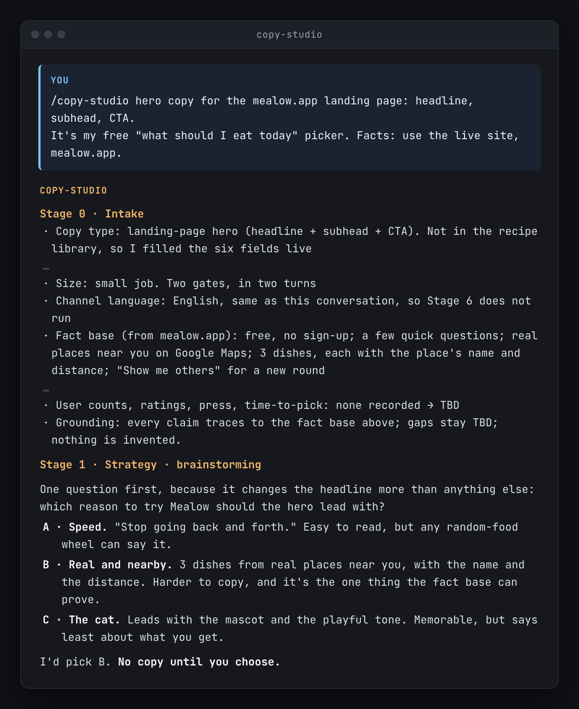
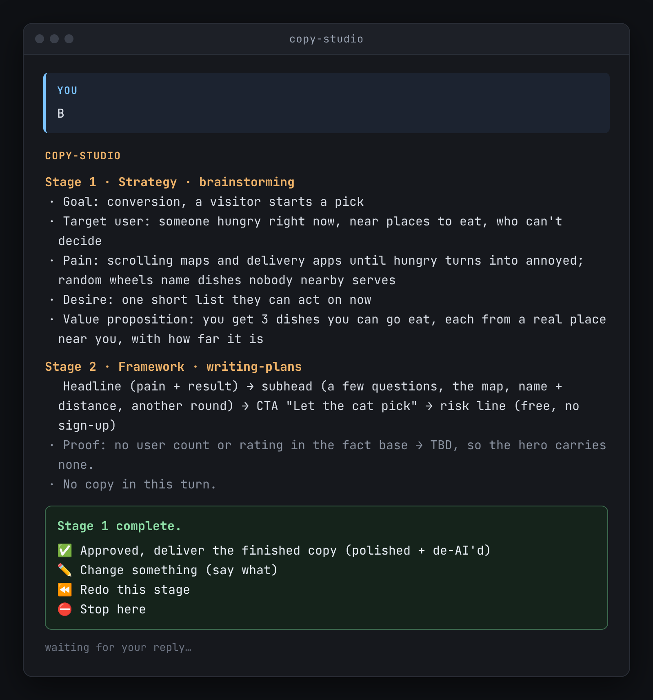
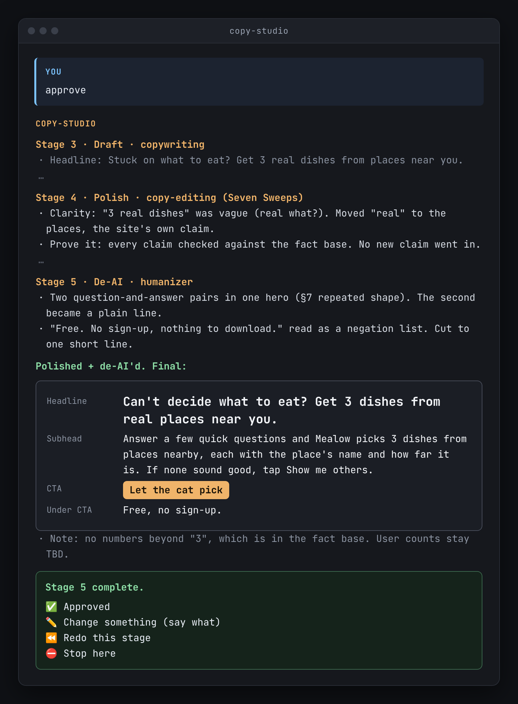

# Copy Studio

[](LICENSE)
[](https://github.com/Ekko237/copy-studio/releases/latest)
[](CHANGELOG.md)

A Claude Code and Codex skill. It runs one marketing-copy job through five stages: **strategy, framework, draft, polish, and de-AI**. It stops for your approval after every stage. An optional sixth stage localizes the approved copy into the channel's language.

[中文说明](README.zh-CN.md)

<p>
  
  <br>
  You give it a job (here, the hero copy for mealow.app) and it asks you to pick a direction before writing anything.
</p>

<p>
  
  <br>
  After each stage it stops and waits for your OK.
</p>

<p>
  
  <br>
  The finished copy, polished and de-AI'd.
</p>

<p><em>From a real run on mealow.app hero copy. Replies at each stop were typed by hand; some lines trimmed.</em></p>

It runs five existing skills. It does not replace them.

| Stage | Skill | What it produces |
|---|---|---|
| 1. Strategy | `brainstorming` | goal, target user, pains, desires, and a result-oriented value proposition |
| 2. Framework | `writing-plans` | block-by-block structure, each block tied to a pain or desire |
| 3. Draft | `copywriting` | the real copy, in the shape of the channel's recipe |
| 4. Polish | `copy-editing` | a line-by-line edit |
| 5. De-AI | `humanizer` | AI tells removed, voice matched, final deliverable |
| 6. Localize *(optional)* | your localization skill | the approved master in the channel's language |

Those five skills are not in this repo. See [Dependencies](#dependencies).

It keeps one strategy from the first stage to the last, and it waits for you between stages.

## Why the stops matter

The failure this skill is built to prevent: an assistant hands you a strategy, a framework, and a finished draft in one message. It has already chosen the angle. That stop has no exceptions. The turn that proposes the direction contains **no candidate copy**. Even a one-line comment reply gets two stops, in two turns. Direction first. Finished copy second.

A small job uses fewer turns. It still runs every stage. A raw Stage 3 draft is not the deliverable.

## What a run looks like

A small job stops once before any copy exists, then once more on the finished piece. The transcript below is that shape. **Northwind Kettle is a placeholder, not a real brand.** The fact base has no price, no customer count, and no awards, so the draft has none either.

```text
You
  /copy-studio an Instagram caption for the spring kettle.
  Someone outfitting a one-person kitchen. The plastic lid on their
  current kettle slips when they pour. They want a kettle they can
  leave on the table.
  Fact base (placeholder only):
    Product: Northwind Kettle, an enamel kettle with a wooden handle
    URL: https://example.invalid/kettle
    Price, ratings, awards, customer counts: none recorded

Copy Studio
  Stage 0 · Intake
    Copy type: social promo caption (Instagram)
    Asset and goal: one caption for the spring kettle
    Size: small job. Two gates, in two turns
    Channel language: English, so Stage 6 does not run
    Grounding: claims trace to the fact base above; gaps stay TBD

  Stage 1 · Strategy · brainstorming
    Goal: acquisition
    Target user: someone outfitting a one-person kitchen
    Pain: the plastic lid on their current kettle slips when they pour
    Desire: a kettle they can leave on the table
    Value proposition: an enamel kettle with a wooden handle
    The pain and the desire are the ones you supplied at intake.

  Stage 2 · Framework · writing-plans
    Hook (slipping lid) → the product as stated (enamel, wooden handle) → bio-link CTA
    No caption in this turn.

  Stage 1 complete.
  ✅ Approved — deliver the finished copy (polished + de-AI'd) · ✏️ Change something (say what) · ⏪ Redo this stage · ⛔ Stop here

You
  Approved

Copy Studio
  Stage 3 · Draft · copywriting
    The lid on my old kettle slips when I pour.
    This one is enamel, with a wooden handle.
    Spring kettle. Link in the bio.

  Stage 4 · Polish · copy-editing
    Line edit. A line that called the handle "effortless" came out:
    that word is not in the fact base. No new claim went in.

  Stage 5 · De-AI · humanizer
    A padded three-item list came out. The wording left is the draft above.
    Polished + de-AI'd. Price and any sales figure are TBD, so they are not in the caption.

  Stage 5 complete. Channel language matches the draft, so this is the deliverable.
  ✅ Approved · ✏️ Change something (say what) · ⏪ Redo this stage · ⛔ Stop here
```

On a big job the same menu is printed after every stage, and the first choice reads `✅ Approved, continue to Stage N+1`. The turn that proposes the direction still contains no candidate copy.

## Install

You need git, bash, tar, and a network connection.

```bash
curl -fsSL https://raw.githubusercontent.com/Ekko237/copy-studio/main/install.sh | bash
```

That installs Copy Studio, the five dependency skills, and the `/copy-studio` command into both `~/.claude` and `~/.codex`.

Verify it works. Open a new Claude Code or Codex session and ask `/copy-studio an Instagram post for the new template library`. You should see Stage 0, then a strategy turn with no candidate copy, and a menu that waits.

Update. Run the same command again. It refreshes the copies this installer manages.

### Claude Code and Codex plugins

These commands install only the orchestrator. They do not install the five dependency skills. From a checkout, `bash scripts/install-deps.sh` installs those five. The command above installs the orchestrator and the five skills together.

Claude Code:

```bash
claude plugin marketplace add Ekko237/copy-studio
claude plugin install copy-studio@copy-studio
```

Codex:

```bash
codex plugin marketplace add Ekko237/copy-studio
codex plugin add copy-studio@copy-studio
```

Claude Code lists one skill, named `copy-studio`. Codex lists `copy-studio:copy-studio`. The install script also adds `/copy-studio`.

<details>
<summary>Other install paths</summary>

### From a checkout

`bash install.sh` does the same thing as the command above. `bash scripts/install-deps.sh` installs only the five dependencies.

The script writes:

- `~/.claude/skills/copy-studio/` and `~/.codex/skills/copy-studio/`
- `brainstorming`, `writing-plans`, `copywriting`, `copy-editing`, and `humanizer`, in both skill folders, under those names
- `~/.claude/commands/copy-studio.md`, which is the `/copy-studio` command

A folder that is already at one of those paths, and that this installer did not put there, is renamed to `*.bak-<timestamp>` first.

Skill folders elsewhere: set `COPY_STUDIO_CLAUDE_HOME` and `COPY_STUDIO_CODEX_HOME`.

### Folder only

This copies Copy Studio and skips the five dependencies. A stage whose skill is missing does not run.

```bash
git clone https://github.com/Ekko237/copy-studio.git
mkdir -p ~/.claude/skills ~/.codex/skills ~/.claude/commands
cp -R copy-studio/skills/copy-studio ~/.claude/skills/copy-studio
cp -R copy-studio/skills/copy-studio ~/.codex/skills/copy-studio
cp copy-studio/commands/copy-studio.md ~/.claude/commands/copy-studio.md
```

### Windows

Run the install command from Git Bash or WSL. `~` is `C:\Users\<you>`.

</details>

## Dependencies

Copy Studio is an orchestrator. It does not contain the five skills it calls. `install.sh` clones them. They stay separate projects, each under its own license.

| Stage | Skill it calls | Where to get it |
|---|---|---|
| 1. Strategy | `brainstorming` | [obra/superpowers](https://github.com/obra/superpowers) → `skills/brainstorming/` |
| 2. Framework | `writing-plans` | [obra/superpowers](https://github.com/obra/superpowers) → `skills/writing-plans/` |
| 3. Draft | `copywriting` | [coreyhaines31/marketingskills](https://github.com/coreyhaines31/marketingskills) → `skills/copywriting/` |
| 4. Polish | `copy-editing` | [coreyhaines31/marketingskills](https://github.com/coreyhaines31/marketingskills) → `skills/copy-editing/` |
| 5. De-AI | `humanizer` | [blader/humanizer](https://github.com/blader/humanizer) |

All three upstream projects are MIT-licensed. Read each repository for its current terms. Copy Studio calls these skills by name, so a newer copy still fits. If one is missing, the stage that calls it does not run. Copy Studio does not fill in with a copy of its own.

Each installed dependency keeps that project's `LICENSE` and an `UPSTREAM` file with the repository URL, path, and commit. Copy Studio does not relicense them.

Stage 6 is optional. It needs a localization skill of your own. The installer does not add one.

## Before your first real run

This repo ships with no brand facts, no product stats, no prize figures, and no sample copy. Inventing a number is the worst failure a copy pipeline can make. Someone else's samples would teach the wrong voice. You create two files:

1. **A fact base.** The only citable source for your product's stats, capabilities, URLs, pricing, and program or reward figures. Quote it verbatim. Anything missing is `TBD`.
2. **A channel calibration file.** Two or three approved real samples per channel you ship to. Samples teach shape and voice better than a description.

[`skills/copy-studio/references/channel-calibration-template.md`](skills/copy-studio/references/channel-calibration-template.md) is the scaffold for both. Once it holds real material it is usually internal. The included `.gitignore` keeps filled-in copies out of git by default.

## Usage

```
/copy-studio an Instagram post for the new template library
```

Or describe the job and let the skill trigger. It starts at **Stage 0 (intake)**: copy type and channel, the asset and goal in one line, scope, output language, and what source material exists. Then one stage per turn, stopping at each gate:

> **Stage N complete.** […output…]
> ✅ Approved, continue to Stage N+1 · ✏️ Change something · ⏪ Redo this stage · ⛔ Stop here

A big job (a whole page, a deck, a campaign) gets a gate after every stage. A small job (one comment, post, caption, or card) gets two: direction first, then the finished copy with polish and de-AI already applied.

Already have a brief? Start at Stage 2. Have a draft you want finished? Start at Stage 4. Just need the AI smell taken off? Invoke `humanizer` directly.

## Common questions

### Why does it stop so often?

The turn that proposes the direction contains no candidate copy. A one-line comment still gets two turns: direction, then finished copy. A big job stops after every stage. A small job uses fewer turns and still runs every stage. A raw Stage 3 draft is not the deliverable.

### Can I skip stages?

Start later when the earlier work already exists. A clear brief starts at Stage 2. A draft to finish starts at Stage 4. If you only want the AI smell taken off, use `humanizer` directly. Final copy that only needs another language starts at Stage 6. What you already have stands in for the earlier stages. Gates still run from the stage you enter. On a small job, stages 3, 4, and 5 run in one pass after you approve the direction, and the result says it was polished and de-AI'd.

### What if a dependency is missing?

The stage that calls it does not run. Copy Studio does not write that stage itself. `install.sh` clones the five skills. Stage 6 needs your own localization skill. The installer does not add one.

### Which tools does this support?

Claude Code and Codex. The install writes to `~/.claude` and `~/.codex`.

### Where do the numbers in the copy come from?

From your fact base. This repo does not ship product stats, prize figures, or sample copy. Anything missing from the fact base stays `TBD`.

## What else is in the pipeline

- **Six fields per copy type.** Shape, must-include, length and voice, CTA and link, grounding, and visual support. A new channel does not need new code. Fill the six fields and it becomes a library row.
- **A recipe library.** Landing-page value cards, community posts, four kinds of comment reply, deck slides, ads, per-platform social captions, email, and image-heavy template email.
- **Channel rules that are easy to get wrong.** Platforms whose in-feed links are not clickable need a bio-link CTA, so two platforms never share one caption. Reddit takes zero links and zero hashtags in the body, keeps rewards out of the brand's main comment, and treats new accounts least generously.
- **A pre-show self-check** the draft must pass before you see it: voice, grounding, shape, length, AI tells, copy-first, channel rules, and language.
- **Localize last.** Translation happens only at Stage 6, and only into that channel's language. One channel means one language. Multi-language output is for site-wide content, not a single comment.

## Working language and deliverable language

The skill separates the language you talk in from the language the copy ships in. That matters when a team works in one language and markets in another. Each deliverable comes with a short note in the working language, so a reviewer who does not read the target language can still give feedback. You can set the defaults at Stage 0.

## Layout

- `README.md`: you are here. [中文说明](README.zh-CN.md)
- `CHANGELOG.md`: release notes
- `install.sh`: one-command install of this skill, the five dependencies, and the slash command
- `scripts/install-deps.sh`: the five dependencies only
- `skills/copy-studio/SKILL.md`: the skill. Stages, gates, recipe library, self-checks
- `commands/copy-studio.md`: the `/copy-studio` slash command. `install.sh` copies it into `~/.claude/commands/`. The Claude plugin does not load this file, so the plugin lists one skill
- `skills/copy-studio/agents/openai.yaml`: Codex agent interface metadata
- `.claude-plugin/`: Claude Code plugin manifest for the orchestrator only
- `.codex-plugin/plugin.json` and `.agents/plugins/marketplace.json`: Codex plugin manifest for the orchestrator only
- `skills/copy-studio/references/channel-calibration-template.md`: scaffold for your fact base and samples
- `scripts/check_skill.py`: structural check for `SKILL.md`
- `scripts/check_frontmatter.py`: checks the skill name and description length

## License

MIT. See [LICENSE](LICENSE).

Tried it? Open an [issue](https://github.com/Ekko237/copy-studio/issues) and tell me what broke or what you made.
