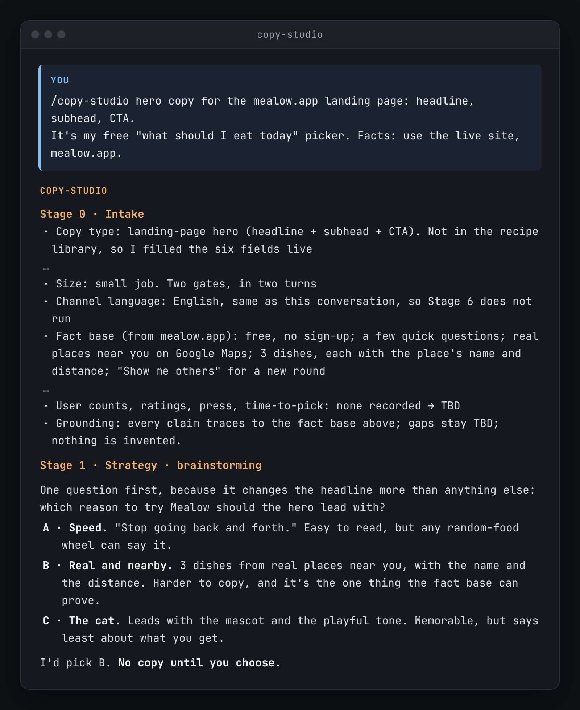
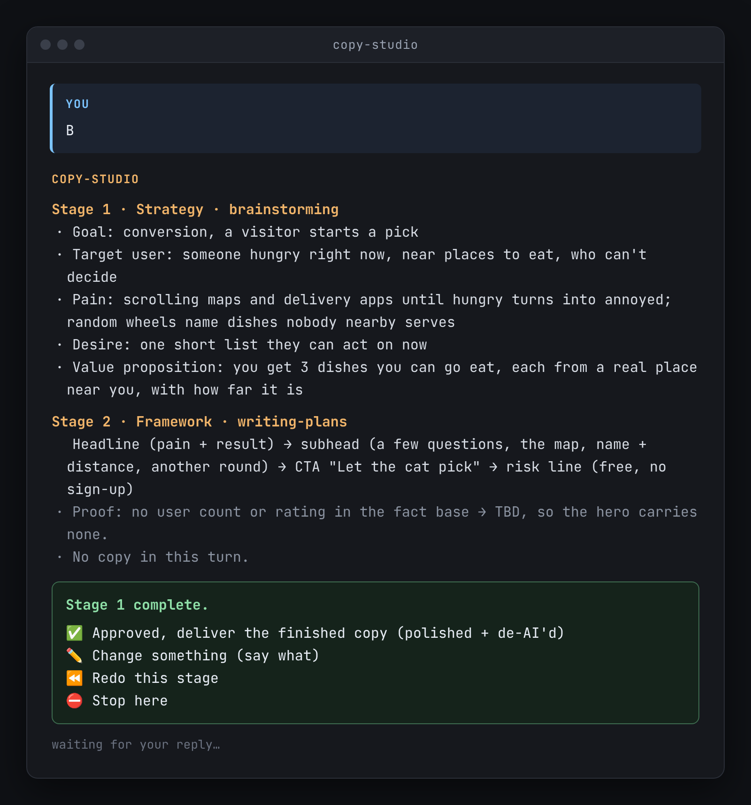
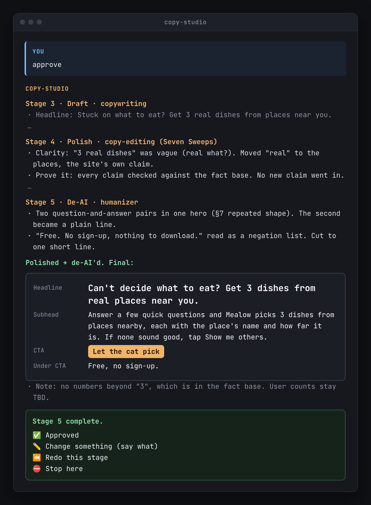

# Copy Studio

[English](README.md) | [简体中文](README.zh-CN.md)

[](LICENSE)
[](https://github.com/Ekko237/copy-studio/releases/latest)
[](CHANGELOG.md)

一个 Claude Code / Codex 技能，用于把一项营销文案工作依次走完策略、结构、起草、润色和去 AI 味，每一步都停下来等用户确认。可选的第六步，会把已经确认的成稿译成这个渠道使用的语言。它调度五个已经存在的技能，不替换或打包它们。

## 适合谁

已经在用 Claude Code 或 Codex、需要把营销文案从简报写成成稿的创始人、市场营销人员和独立开发者。适用内容包括落地页模块、社群帖子、评论回复、演示文稿、广告、社媒配文和邮件。任何成稿出现之前，你都可以先批准方向。

## 为什么现在就该试

这个技能要挡住的失败是：助手在同一条消息里交出策略、结构和成稿，角度已经替你选好了。Copy Studio 会挡住这一点。提出方向的那一轮里，**没有任何候选成稿**。这一停没有例外。

小任务可以少用几轮，但每一步仍然照跑。第 3 步的原始草稿不是交付物。

仓库里已经有一次真实运行的截图：mealow.app 的首屏文案。每一处停下来的回复都是手打的；有些行做了删节。

```bash
curl -fsSL https://raw.githubusercontent.com/Ekko237/copy-studio/main/install.sh | bash
```

这会把 Copy Studio、五个依赖技能和 `/copy-studio` 命令装进 `~/.claude` 和 `~/.codex`。

需要 git、bash、tar 和网络连接。

skills CLI 是另一条安装路径：

`npx skills add https://github.com/Ekko237/copy-studio --skill copy-studio` 只会通过 npx skills CLI 安装调度器（支持 Claude Code、Codex 和其他代理），不会安装五个依赖技能，也不会安装 `/copy-studio` 斜杠命令。技能会被复制到你运行该命令时所在目录的 `.agents/skills/copy-studio`。如果安装器要你确认，可以加上 `-y`。之后在检出目录运行 `bash scripts/install-deps.sh` 可补装依赖。

[用法](#用法) · [反馈 issue](https://github.com/Ekko237/copy-studio/issues) · [贡献指南](CONTRIBUTING.md) · [ClawHub](https://clawhub.ai/ekko237/skills/copy-studio)

如果这个项目对你有帮助，点一个 ★ Star 能帮助其他人找到它。

## 运行要求

- 安装 `install.sh` 需要 git、bash、tar 和网络连接
- 只有使用 `npx skills` 路径时才需要 Node.js
- Claude Code 和/或 Codex；安装器会写入 `~/.claude` 和 `~/.codex`
- 完整运行至少需要五个依赖技能；`install.sh` 会克隆它们。缺少技能时，对应步骤不会运行——Copy Studio 不会自己写那一步
- 第 6 步是可选的，需要你自己的本地化技能；安装器不提供
- Windows：在 Git Bash 或 WSL 中运行安装命令；`~` 对应 `C:\Users\<用户名>`

<table>
  <tr>
    <td width="33%"></td>
    <td width="33%"></td>
    <td width="33%"></td>
  </tr>
  <tr>
    <td>你给它一个任务（这里是 mealow.app 的首屏文案），它先让你选一个方向，再开始写。</td>
    <td>每一步结束后，它都会停下来等你确认。</td>
    <td>成稿已经润色，并去掉了 AI 味。</td>
  </tr>
</table>

<p><em>来自 mealow.app 首屏文案的一次真实运行。每一处停下来的回复都是手打的；有些行做了删节。</em></p>

| 步骤 | 技能 | 产出 |
| --- | --- | --- |
| 1. 策略 | `brainstorming` | 目标、目标用户、痛点、欲望，以及结果导向的价值主张 |
| 2. 结构 | `writing-plans` | 一块一块的结构，每一块对应一个痛点或欲望 |
| 3. 起草 | `copywriting` | 按这个渠道的配方写成的正文 |
| 4. 润色 | `copy-editing` | 逐行修改 |
| 5. 去 AI 味 | `humanizer` | 去掉 AI 痕迹，对齐语气，交付成稿 |
| 6. 本地化 *(可选)* | 你自己的本地化技能 | 将确认过的母稿译成渠道语言 |

这五个技能不在本仓库里。见[依赖技能](#依赖技能)。

## 快速使用

```text
/copy-studio an Instagram post for the new template library
```

安装后新开一个 Claude Code 或 Codex 会话。你应该看到第 0 步、一轮没有候选成稿的策略，以及一份等待输入的关口菜单。

真正开始工作前，按下面的说明准备事实库和渠道校准文件。已有简报？从第 2 步开始。已有草稿需要收尾？从第 4 步开始。只想去掉 AI 味？直接调用 `humanizer`。

## 什么时候别用

- 不适合论文、小说或渠道营销文案以外的普通写作
- 不适合不想经过批准关口的一次性成稿
- 不适合不用 Claude Code 或 Codex 的情况；它们是受支持的工具，安装器会写入 `~/.claude` 和 `~/.codex`
- 不适合让模型编造统计数字、价格、奖项或用户数；本仓库不带品牌事实，事实库里缺少的任何说法都保持为 `TBD`
- 如果只需要一个步骤，不要把它当成五个上游技能的替代品
- 除非你提供自己的本地化技能，第 6 步不会运行

## 和其他做法比

| 做法 | 权衡 |
| --- | --- |
| 在一条消息里让普通聊天模型“写文案” | 没有关口；角度由模型决定 |
| 自己按顺序调用五个技能 | 技能相同，但需要自己保持策略一致并记住关口 |
| Copy Studio | 调度这些技能，从第 1 步到最后只用一个策略，并在候选成稿出现前硬性停下 |

聘请文案写手是另一种选择：人可以带来判断和研究。这个技能不会替代这个角色。

## 为什么每一步都要停

这个技能要挡住的失败是：助手在同一条消息里交出策略、结构和成稿。它在你能引导之前就已经选好了角度。Copy Studio 会挡住这一点。提出方向的那一轮里，**没有任何候选成稿**。这一停没有例外。

小任务可以少用几轮，但每一步仍然照跑。第 3 步的原始草稿不是交付物。

## 一次运行长什么样

小任务会在任何成稿出现之前停一次，成稿出来后再停一次。下面就是这个形状。**Northwind Kettle 是占位品牌，不是真实产品。** 事实库里没有价格、没有用户数、没有奖项，所以成稿里也没有。

<details>
<summary>运行记录</summary>

```text
You
  /copy-studio an Instagram caption for the spring kettle.
  Someone outfitting a one-person kitchen. The plastic lid on their
  current kettle slips when they pour. They want a kettle they can
  leave on the table.
  Fact base (placeholder only):
    Product: Northwind Kettle, an enamel kettle with a wooden handle
    URL: https://example.invalid/kettle
    Price, ratings, awards, customer counts: none recorded

Copy Studio
  Stage 0 · Intake
    Copy type: social promo caption (Instagram)
    Asset and goal: one caption for the spring kettle
    Size: small job. Two gates, in two turns
    Channel language: English, so Stage 6 does not run
    Grounding: claims trace to the fact base above; gaps stay TBD

  Stage 1 · Strategy · brainstorming
    Goal: acquisition
    Target user: someone outfitting a one-person kitchen
    Pain: the plastic lid on their current kettle slips when they pour
    Desire: a kettle they can leave on the table
    Value proposition: an enamel kettle with a wooden handle
    The pain and the desire are the ones you supplied at intake.

  Stage 2 · Framework · writing-plans
    Hook (slipping lid) → the product as stated (enamel, wooden handle) → bio-link CTA
    No caption in this turn.

  Stage 1 complete.
  ✅ Approved — deliver the finished copy (polished + de-AI'd) · ✏️ Change something (say what) · ⏪ Redo this stage · ⛔ Stop here

You
  Approved

Copy Studio
  Stage 3 · Draft · copywriting
    The lid on my old kettle slips when I pour.
    This one is enamel, with a wooden handle.
    Spring kettle. Link in the bio.

  Stage 4 · Polish · copy-editing
    Line edit. A line that called the handle "effortless" came out:
    that word is not in the fact base. No new claim went in.

  Stage 5 · De-AI · humanizer
    A padded three-item list came out. The wording left is the draft above.
    Polished + de-AI'd. Price and any sales figure are TBD, so they are not in the caption.

  Stage 5 complete. Channel language matches the draft, so this is the deliverable.
  ✅ Approved · ✏️ Change something (say what) · ⏪ Redo this stage · ⛔ Stop here
```

</details>

大任务每一步之后都会打印同一份菜单，第一项是 `✅ Approved, continue to Stage N+1`。提出方向的那一轮里仍然没有候选成稿。

## 其他安装方式

<details>
<summary>Claude Code 插件</summary>

插件命令只安装调度器，不安装五个依赖技能。

```bash
claude plugin marketplace add Ekko237/copy-studio
claude plugin install copy-studio@copy-studio
```

Claude Code 列出一个技能，名字是 `copy-studio`。

</details>

<details>
<summary>Codex 插件</summary>

```bash
codex plugin marketplace add Ekko237/copy-studio
codex plugin add copy-studio@copy-studio
```

Codex 列出的是 `copy-studio:copy-studio`。

</details>

<details>
<summary>从检出的仓库安装</summary>

`bash install.sh` 和上面的 curl 命令做的是同一件事。`bash scripts/install-deps.sh`只安装五个依赖。

脚本会写入：

- `~/.claude/skills/copy-studio/` 和 `~/.codex/skills/copy-studio/`
- `brainstorming`、`writing-plans`、`copywriting`、`copy-editing`、`humanizer`，放在两个技能目录下，文件夹名就是这些名字
- `~/.claude/commands/copy-studio.md`（`/copy-studio`）

如果这些路径上已有目录，而且不是这个安装器放进去的，脚本会先把它改名为 `*.bak-<时间戳>`。

自定义路径：`COPY_STUDIO_CLAUDE_HOME` 和 `COPY_STUDIO_CODEX_HOME`。

重新运行安装命令，可以刷新这个安装器管理的副本。

</details>

<details>
<summary>只复制技能目录</summary>

这个方式只复制 Copy Studio，不安装五个依赖。缺少哪个技能，对应步骤就不会运行。

```bash
git clone https://github.com/Ekko237/copy-studio.git
mkdir -p ~/.claude/skills ~/.codex/skills ~/.claude/commands
cp -R copy-studio/skills/copy-studio ~/.claude/skills/copy-studio
cp -R copy-studio/skills/copy-studio ~/.codex/skills/copy-studio
cp copy-studio/commands/copy-studio.md ~/.claude/commands/copy-studio.md
```

</details>

## 依赖技能

Copy Studio 是调度器，不打包自己调用的五个技能。`install.sh` 会直接从上游仓库克隆它们，每个技能保留自己的许可。

| 步骤 | 调用的技能 | 上游地址 |
| --- | --- | --- |
| 1. 策略 | `brainstorming` | [obra/superpowers](https://github.com/obra/superpowers) → `skills/brainstorming/` |
| 2. 结构 | `writing-plans` | [obra/superpowers](https://github.com/obra/superpowers) → `skills/writing-plans/` |
| 3. 起草 | `copywriting` | [coreyhaines31/marketingskills](https://github.com/coreyhaines31/marketingskills) → `skills/copywriting/` |
| 4. 润色 | `copy-editing` | [coreyhaines31/marketingskills](https://github.com/coreyhaines31/marketingskills) → `skills/copy-editing/` |
| 5. 去 AI 味 | `humanizer` | [blader/humanizer](https://github.com/blader/humanizer) |

三个上游项目都是 MIT 许可。请自行以各仓库里现行条款为准。Copy Studio 按名字调用这些技能。缺少一个技能时，对应步骤不会运行——Copy Studio 不会自己写那一步。

每个已安装的依赖都保留原来的 `LICENSE` 和 `UPSTREAM` 文件。Copy Studio 不会把它们改成自己的许可。

第 6 步是可选的，需要你自己的本地化技能。安装器不提供。

## 第一次真正跑之前

这个仓库不带品牌事实、产品数据、奖项数字或示例文案。真正开始工作前，请准备：

1. **事实库。** 这是产品数据、能力、网址、定价和活动或奖励数字的唯一可引用来源。Copy Studio 会按原文引用它，缺少的说法写成 `TBD`。
2. **渠道校准文件。** 每个要投放的渠道准备两三条已经通过的真实样本。样本比描述更能教会形状和语气。

用 [`skills/copy-studio/references/channel-calibration-template.md`](skills/copy-studio/references/channel-calibration-template.md) 作为两份材料的模板。仓库自带的 `.gitignore` 默认会让填好的副本留在 git 之外。

**填好的文件放在安装好的技能目录之外。** 重新安装或更新时，`install.sh` 会替换它管理的每个目录（`~/.claude/skills/copy-studio/`、`~/.codex/skills/copy-studio/`，以及五个依赖技能的目录）：先删掉里面已有的内容，再复制一份新的进去。只有不是它放的文件夹才会改名为 `*.bak-<时间戳>`。你放进受管目录里的事实库或校准文件都会被删掉，不管 git 是否忽略它。把填好的副本存在这两个受管技能目录之外的私有位置，开始任务时把这些路径告诉代理。

## 用法

```text
/copy-studio an Instagram post for the new template library
```

也可以直接描述任务，让技能自己触发。它从**第 0 步（受理）**开始：文案类型和渠道、资产与目标（用一行说明）、规模、输出语言以及可用材料。然后每轮运行一步，并停在关口：

> **Stage N complete.** […output…]
> ✅ Approved, continue to Stage N+1 · ✏️ Change something · ⏪ Redo this stage · ⛔ Stop here

大任务（整页、幻灯片、活动）每一步都有关口。小任务（一条评论、一篇帖子、一条配文、一张卡片）有两道关：先批准方向，再交付已经润色并去掉 AI 味的成稿。

已有简报？从第 2 步开始。已有草稿需要收尾？从第 4 步开始。只想去掉 AI 味？直接调用 `humanizer`。

## 常见问题

**为什么经常停下来？**

提出方向的那一轮里没有候选成稿。一条评论也会走两轮：先方向，后成稿。大任务每一步都停。小任务轮次更少，但步骤不减少。第 3 步的草稿不是交付物。

**可以跳过步骤吗？**

如果更早的材料已经有了，可以跳过。已有简报可从第 2 步开始，有草稿可从第 4 步开始，只需要翻译成稿可从第 6 步开始。只想去掉 AI 味，可直接调用 `humanizer`。现有输入替代更早的步骤；从进入的步骤起，关口照常运行。小任务里，你批准方向之后，第 3、4、5 步会在同一轮跑完，结果会标明已经润色并去掉了 AI 味。

**缺少一个依赖会怎样？**

调用它的那一步不会运行。Copy Studio 不会自己写这一步。`install.sh` 会克隆五个技能，第 6 步需要你自己的本地化技能，安装器不会添加。

**它支持哪些工具？**

Claude Code 和 Codex。安装器会写入 `~/.claude` 和 `~/.codex`。

**文案里的数字从哪里来？**

从事实库来。本仓库不带产品数据、奖项数字或示例文案。事实库里缺少的说法会保持为 `TBD`。

## 流程里还有什么

- **每种文案六个字段。** 形状、必须包含、长度和语气、行动号召和链接、依据、视觉支持。加一个新渠道不用改代码，把这六个字段填好，配方库里就多一行。
- **配方库。** 涵盖落地页价值卡片、社群帖子、四种评论回复、演示文稿、广告、分平台社媒配文、邮件，以及偏图的模板邮件。
- **容易写错的渠道限制。** 信息流里的链接点不了的平台，行动号召要指向简介里的链接，所以两个平台不能共用一条配文。Reddit 正文里不能有链接、不能有话题标签，品牌主评论里不写奖励，新账号更要克制。
- **给你看之前的自检。** 草稿必须先过：语气、依据、形状、长度、AI 痕迹、先写文字、渠道规则、语言。
- **最后才翻译。** 翻译只发生在第 6 步，而且只译成这个渠道的那一种语言。一个渠道一种语言。多语言展开是给全站内容的，不是给一条评论的。

## 工作语言与成稿语言

技能会把你与代理交流的工作语言和文案交付的成稿语言分开。每份交付都会附一段工作语言的说明，方便不懂目标语言的审核者给反馈。两种语言的默认值都可以在第 0 步设置。

## 文件结构

<details>
<summary>文件结构</summary>

```
├─ skills/                 Copy Studio 技能：SKILL.md、references 和 agents
├─ commands/               /copy-studio 斜杠命令
├─ scripts/                依赖安装器和技能检查
├─ docs/                   README 截图
├─ CONTRIBUTING.md         贡献指南
├─ CODE_OF_CONDUCT.md      行为准则
├─ install.sh              一键安装脚本
├─ CHANGELOG.md            更新记录
├─ .claude-plugin/         Claude Code 市场和插件清单
├─ .codex-plugin/          Codex 插件清单
├─ .agents/                Codex 市场清单
└─ .github/                issue 模板、PR 模板和 CI 工作流
```

</details>

## 许可

Copy Studio 本身是 MIT 许可；详见 [LICENSE](LICENSE)。五个依赖技能保留各自仓库中的许可，安装器不会把它们改成自己的许可。

用过了？开一个 [issue](https://github.com/Ekko237/copy-studio/issues)，告诉我哪里坏了，或者你做成了什么。

欢迎提交 issue 和 pull request，见 [CONTRIBUTING.md](CONTRIBUTING.md)。
