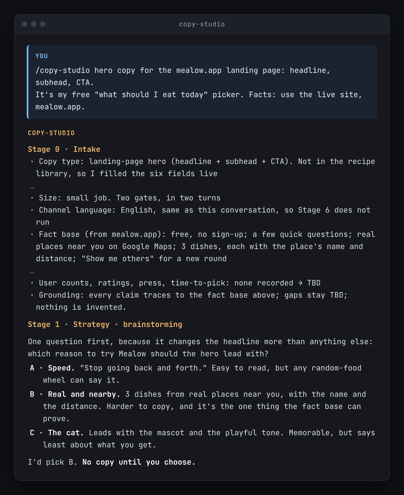
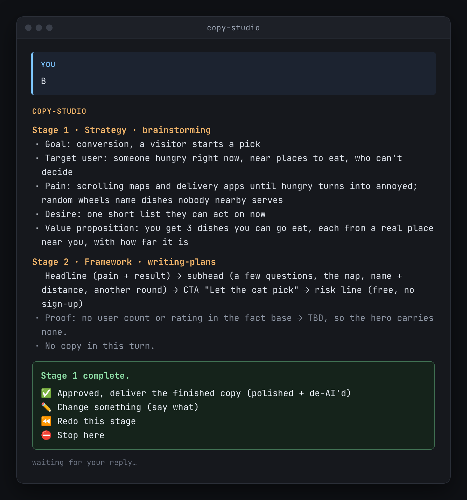
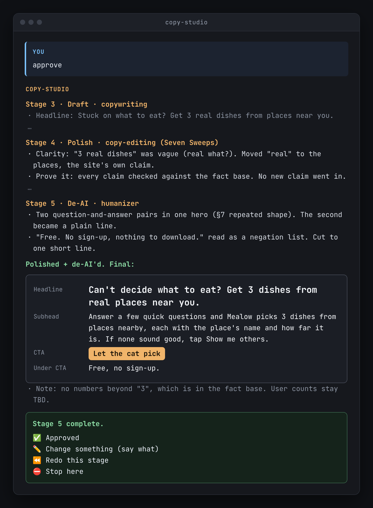

# Copy Studio

[](LICENSE)
[](https://github.com/Ekko237/copy-studio/releases/latest)
[](CHANGELOG.md)

一个 Claude Code 和 Codex 技能。它把一条营销文案走完五步：**策略、结构、起草、润色、去 AI 味**。每一步结束都停下来等你确认。可选的第六步，把已经确认的成稿译成这个渠道使用的语言。

[English](README.md)

<table>
  <tr>
    <td width="33%"></td>
    <td width="33%"></td>
    <td width="33%"></td>
  </tr>
  <tr>
    <td>你给它一个任务（这里是 mealow.app 的首屏文案），它先让你选一个方向，再开始写。</td>
    <td>每一步结束后，它都会停下来等你确认。</td>
    <td>成稿已经润色，并去掉了 AI 味。</td>
  </tr>
</table>

<p><em>来自 mealow.app 首屏文案的一次真实运行。每一处停下来的回复都是手打的；有些行做了删节。</em></p>

它调度五个已经存在的技能，不替换它们。

| 步骤 | 技能 | 产出 |
|---|---|---|
| 1. 策略 | `brainstorming` | 目标、目标用户、痛点、欲望，以及结果导向的价值主张 |
| 2. 结构 | `writing-plans` | 一块一块的结构，每一块对应一个痛点或欲望 |
| 3. 起草 | `copywriting` | 按这个渠道的配方写成的正文 |
| 4. 润色 | `copy-editing` | 逐行修改 |
| 5. 去 AI 味 | `humanizer` | 去掉 AI 痕迹，对齐语气，作为最终交付 |
| 6. 本地化 *(可选)* | 你自己的本地化技能 | 把确认过的母稿译成渠道语言 |

这五个技能都不在本仓库里。见[依赖技能](#依赖技能)。

它把一条策略从第一步贯彻到最后一步，并且在步骤之间等你。

## 为什么每一步都要停

这个技能要挡住的失败是：助手在同一条消息里同时交出策略、结构和成稿。角度其实已经替你定了。这一关没有例外。提出方向的那一轮里**没有任何候选成稿**。哪怕只回一句评论，也是两轮：先方向，后成稿。

小任务可以少几轮对话。每一步仍然要跑。第 3 步的草稿不是交付物。

## 一次运行长什么样

小任务会在任何成稿出现之前停一次，成稿出来再停一次。下面就是这个形状。**Northwind Kettle 是占位品牌，不是真实产品。** 事实库里没有价格、没有用户数、没有奖项，所以成稿里也没有。

<details>
<summary>运行记录</summary>

```text
You
  /copy-studio an Instagram caption for the spring kettle.
  Someone outfitting a one-person kitchen. The plastic lid on their
  current kettle slips when they pour. They want a kettle they can
  leave on the table.
  Fact base (placeholder only):
    Product: Northwind Kettle, an enamel kettle with a wooden handle
    URL: https://example.invalid/kettle
    Price, ratings, awards, customer counts: none recorded

Copy Studio
  Stage 0 · Intake
    Copy type: social promo caption (Instagram)
    Asset and goal: one caption for the spring kettle
    Size: small job. Two gates, in two turns
    Channel language: English, so Stage 6 does not run
    Grounding: claims trace to the fact base above; gaps stay TBD

  Stage 1 · Strategy · brainstorming
    Goal: acquisition
    Target user: someone outfitting a one-person kitchen
    Pain: the plastic lid on their current kettle slips when they pour
    Desire: a kettle they can leave on the table
    Value proposition: an enamel kettle with a wooden handle
    The pain and the desire are the ones you supplied at intake.

  Stage 2 · Framework · writing-plans
    Hook (slipping lid) → the product as stated (enamel, wooden handle) → bio-link CTA
    No caption in this turn.

  Stage 1 complete.
  ✅ Approved — deliver the finished copy (polished + de-AI'd) · ✏️ Change something (say what) · ⏪ Redo this stage · ⛔ Stop here

You
  Approved

Copy Studio
  Stage 3 · Draft · copywriting
    The lid on my old kettle slips when I pour.
    This one is enamel, with a wooden handle.
    Spring kettle. Link in the bio.

  Stage 4 · Polish · copy-editing
    Line edit. A line that called the handle "effortless" came out:
    that word is not in the fact base. No new claim went in.

  Stage 5 · De-AI · humanizer
    A padded three-item list came out. The wording left is the draft above.
    Polished + de-AI'd. Price and any sales figure are TBD, so they are not in the caption.

  Stage 5 complete. Channel language matches the draft, so this is the deliverable.
  ✅ Approved · ✏️ Change something (say what) · ⏪ Redo this stage · ⛔ Stop here
```

</details>

大任务会在每一步之后印出同一份菜单，第一项是 `✅ Approved, continue to Stage N+1`。提出方向的那一轮里，仍然没有候选成稿。

## 安装

```bash
npx skills add https://github.com/Ekko237/copy-studio --skill copy-studio
```

这条命令不安装五个依赖技能；`install.sh` 会把它们和 Copy Studio 一起装上，检出后运行 `bash scripts/install-deps.sh` 只装这五个。

这条命令通过 [`npx skills`](https://github.com/vercel-labs/skills) CLI 安装本技能（Claude Code、Codex 和其他代理都能用）。

你需要 git、bash、tar，以及网络。

<details>
<summary>install.sh</summary>

```bash
curl -fsSL https://raw.githubusercontent.com/Ekko237/copy-studio/main/install.sh | bash
```

这条命令会把 Copy Studio、五个依赖技能，以及 `/copy-studio` 命令装进 `~/.claude` 和 `~/.codex`。

</details>

<details>
<summary>Claude Code 插件</summary>

下面的命令只安装调度器，不安装五个依赖技能。在检出的仓库里运行 `bash scripts/install-deps.sh` 可以装上这五个。`install.sh` 会把调度器和这五个技能一起装上。

Claude Code：

```bash
claude plugin marketplace add Ekko237/copy-studio
claude plugin install copy-studio@copy-studio
```

Claude Code 只列出一个技能，名字是 `copy-studio`。安装脚本还会加上 `/copy-studio`。

</details>

<details>
<summary>Codex 插件</summary>

Codex：

```bash
codex plugin marketplace add Ekko237/copy-studio
codex plugin add copy-studio@copy-studio
```

Codex 列出的是 `copy-studio:copy-studio`。

</details>

<details>
<summary>其他安装方式</summary>

### 从本仓库的检出运行

`bash install.sh` 和上面的 `curl` 命令做的是同一件事。`bash scripts/install-deps.sh` 只安装那五个依赖。

脚本会写入：

- `~/.claude/skills/copy-studio/` 和 `~/.codex/skills/copy-studio/`
- `brainstorming`、`writing-plans`、`copywriting`、`copy-editing`、`humanizer`，两个技能目录里各一份，文件夹名就是这些名字
- `~/.claude/commands/copy-studio.md`，也就是 `/copy-studio` 命令

某个路径上如果已经有文件夹，而且不是这个安装器放的，会先改名为 `*.bak-<时间戳>`。

技能目录不在默认位置时，设置 `COPY_STUDIO_CLAUDE_HOME` 和 `COPY_STUDIO_CODEX_HOME`。

### 只装文件夹

这样只复制 Copy Studio，不装五个依赖。缺了哪个技能，调用它的那一步就跑不了。

```bash
git clone https://github.com/Ekko237/copy-studio.git
mkdir -p ~/.claude/skills ~/.codex/skills ~/.claude/commands
cp -R copy-studio/skills/copy-studio ~/.claude/skills/copy-studio
cp -R copy-studio/skills/copy-studio ~/.codex/skills/copy-studio
cp copy-studio/commands/copy-studio.md ~/.claude/commands/copy-studio.md
```

### Windows

在 Git Bash 或 WSL 里运行安装命令。`~` 就是 `C:\Users\<你>`。

</details>

确认它能用。新开一个 Claude Code 或 Codex 会话，输入 `/copy-studio an Instagram post for the new template library`。你应该先看到第 0 步，然后是一轮没有候选成稿的策略，以及一份停下来等你的菜单。

更新。再跑一次安装命令。它会刷新这个安装器自己放进去的副本。

## 依赖技能

Copy Studio 是调度器。它不包含自己所调用的那五个技能。`install.sh` 会克隆它们。它们仍然是别人的项目，各自保留自己的许可。

| 步骤 | 调用的技能 | 从哪里来 |
|---|---|---|
| 1. 策略 | `brainstorming` | [obra/superpowers](https://github.com/obra/superpowers) → `skills/brainstorming/` |
| 2. 结构 | `writing-plans` | [obra/superpowers](https://github.com/obra/superpowers) → `skills/writing-plans/` |
| 3. 起草 | `copywriting` | [coreyhaines31/marketingskills](https://github.com/coreyhaines31/marketingskills) → `skills/copywriting/` |
| 4. 润色 | `copy-editing` | [coreyhaines31/marketingskills](https://github.com/coreyhaines31/marketingskills) → `skills/copy-editing/` |
| 5. 去 AI 味 | `humanizer` | [blader/humanizer](https://github.com/blader/humanizer) |

三个上游项目都是 MIT 许可。以各仓库里的现行条款为准。Copy Studio 按名字调用它们，所以上游更新之后仍然对得上。缺一个，调用它的那一步就跑不了。Copy Studio 不会拿自己的文字去顶替。

每个装好的依赖都保留那个项目的 `LICENSE`，以及一个 `UPSTREAM` 文件，里面是仓库地址、路径和 commit。Copy Studio 不会把它们改成自己的许可。

第 6 步是可选的，需要你自己的本地化技能。安装器不会加一个进来。

## 第一次真正跑之前

这个仓库不带品牌事实、产品数据、奖金数字和示例文案。编造一个数字，是文案流水线最糟的失败。别人的例句也会教错语气。有两份材料要你自己写：

1. **事实库。** 产品数据、能力、网址、定价、活动或奖励数字，唯一可以引用的来源。逐字引用。里面没有的写成 `TBD`。
2. **渠道校准文件。** 每个你要发的渠道，放两三条已经通过的真实例句。例句比描述更能教形状和语气。

[`skills/copy-studio/references/channel-calibration-template.md`](skills/copy-studio/references/channel-calibration-template.md) 是这两份材料的架子。一旦填了真实内容，它通常就是内部文件。仓库自带的 `.gitignore` 默认不把填好的副本放进 git。

## 用法

```
/copy-studio an Instagram post for the new template library
```

也可以直接描述任务，让技能自己触发。它从**第 0 步（受理）**开始：文案类型和渠道、资产和目标（一行）、规模、输出语言，以及你手头有什么材料。然后一轮一步，每步停在关口：

> **Stage N complete.** […output…]
> ✅ Approved, continue to Stage N+1 · ✏️ Change something · ⏪ Redo this stage · ⛔ Stop here

大任务（整页、整套幻灯片、一整场活动）每一步都有关口。小任务（一条评论、一篇帖子、一条配文、一张卡片）有两道关：先方向，然后是已经润色并去掉 AI 味的成稿。

已经有简报？从第 2 步开始。有一篇想收尾的草稿？从第 4 步开始。只想去掉 AI 味？直接调用 `humanizer`。

## 常见问题

**为什么经常停下来？**

提出方向的那一轮里没有任何候选成稿。一条评论也是两轮：先方向，后成稿。大任务每一步都停。小任务轮次更少，步骤不减少。第 3 步的草稿不是交付物。

**可以跳过某些步骤吗？**

更早的工作已经有了，就可以从后面开始。简报清楚，从第 2 步开始。有一篇要收尾的草稿，从第 4 步开始。只去掉 AI 味，直接用 `humanizer`。成稿只需要另一种语言，从第 6 步开始。你已经有的材料，就代替更早的步骤。从你进入的那一步起，关口照常停。小任务在你确认方向之后，会把第 3、4、5 步一次跑完，并写明已经润色、已经去掉 AI 味。

**缺了一个依赖会怎样？**

调用它的那一步不跑。Copy Studio 不会自己写一版顶上。`install.sh` 会克隆那五个技能。第 6 步要你自己的本地化技能。安装器不会加一个。

**它支持哪些工具？**

Claude Code 和 Codex。安装会写到 `~/.claude` 和 `~/.codex`。

**文案里的数字从哪来？**

从你自己的事实库来。这个仓库不带产品数据、奖金数字和示例文案。事实库里没有的，保持为 `TBD`。

## 流程之外还有什么

- **每种文案六个字段。** 形状、必须包含、长度和语气、行动号召和链接、依据、视觉。新渠道不用改代码。当场填好这六个字段，它就成为配方表里的一行。
- **一份配方表。** 落地页价值卡片、社群帖、四种评论回复、幻灯片、广告、各平台社媒配文、邮件，以及图片很多的模板邮件。
- **容易写错的渠道限制。** 信息流里的链接点不了的平台，行动号召要指向简介里的链接，所以两个平台不能共用一条配文。Reddit 正文里不能有链接、不能有话题标签，品牌主评论里不写奖励，新账号更要克制。
- **给你看之前的自检。** 草稿必须先过：语气、依据、形状、长度、AI 痕迹、先写文字、渠道规则、语言。
- **最后才翻译。** 翻译只发生在第 6 步，而且只译成这个渠道的那一种语言。一个渠道一种语言。多语言展开是给全站内容的，不是给一条评论的。

## 工作语言和成稿语言

技能把你说话用的语言和文案发出去用的语言分开。团队用一种语言工作、用另一种语言做市场时，这很有用。每份交付旁边有一段工作语言的短注，说明每一行在做什么，这样看不懂目标语言的人也能提意见。默认值在第 0 步可以改。

## 文件

- `README.zh-CN.md`: 你在这里。[English](README.md)
- `CHANGELOG.md`: 更新记录（英文）
- `install.sh`: 一条命令装上本技能、五个依赖和斜杠命令
- `scripts/install-deps.sh`: 只装五个依赖
- `skills/copy-studio/SKILL.md`: 技能正文。步骤、关口、配方表、自检
- `commands/copy-studio.md`: `/copy-studio` 斜杠命令。`install.sh` 会把它复制到 `~/.claude/commands/`。Claude 插件不加载这个文件，所以插件里只有一个技能
- `skills/copy-studio/agents/openai.yaml`: Codex 的代理界面元数据
- `.claude-plugin/`: Claude Code 插件清单，只包含调度器
- `.codex-plugin/plugin.json` 和 `.agents/plugins/marketplace.json`: Codex 插件清单，只包含调度器
- `skills/copy-studio/references/channel-calibration-template.md`: 事实库和例句的架子
- `scripts/check_skill.py`: 检查 `SKILL.md` 的结构
- `scripts/check_frontmatter.py`: 检查技能名和描述长度

## 许可

Copy Studio 本身是 MIT，见 [LICENSE](LICENSE)。五个依赖技能保持各自仓库里的许可，安装器不会改写。

用过了？开一个 [issue](https://github.com/Ekko237/copy-studio/issues)，告诉我哪里坏了，或者你做成了什么。
